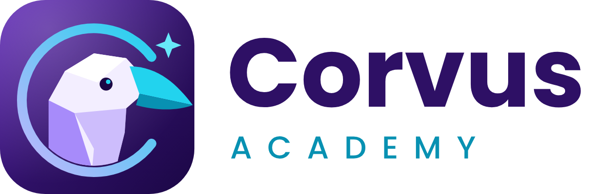
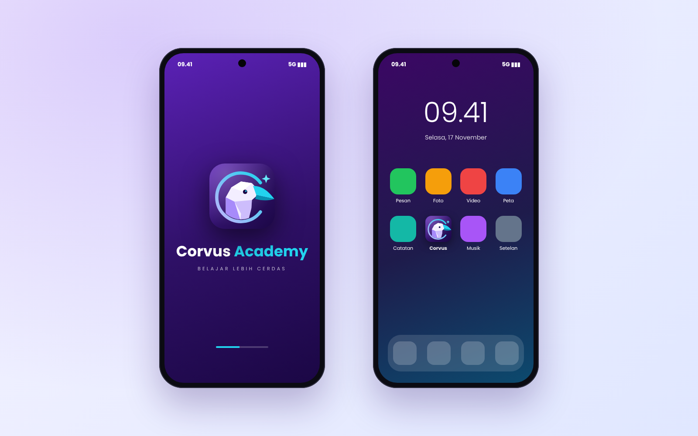

<p align="center">
  
</p>

<h3 align="center">Corvus Academy untuk Android</h3>
<p align="center"><b>by EK Instrumentation</b><br>Materi, tryout, bank soal, dan whiteboard interaktif dalam satu aplikasi.</p>

<p align="center">
  <a href="https://github.com/efendiyhy/corvus-apk/releases/latest/download/corvus-academy.apk"></a>
  <a href="https://github.com/efendiyhy/corvus-apk/releases/latest"></a>
</p>
<p align="center">
  
  
  
</p>

---

## Unduh dan pasang

1. Buka halaman **[Releases](https://github.com/efendiyhy/corvus-apk/releases/latest)** lalu unduh `corvus-academy-vX.Y.Z.apk`. Tautan cepat untuk versi terbaru:
   **[corvus-academy.apk](https://github.com/efendiyhy/corvus-apk/releases/latest/download/corvus-academy.apk)**
2. Buka berkas yang diunduh. Bila diminta, izinkan **Pasang dari sumber ini** untuk browser atau pengelola berkas Anda.
3. Buka **Corvus Academy** dan masuk dengan akun yang diberikan sekolah atau pengajar Anda.

> Setiap rilis menyertakan checksum SHA-256 untuk memeriksa keutuhan berkas.

## Fitur

| | |
|---|---|
| **Materi dan cara cepat** | Ringkasan materi SNBT/TKA dengan simulasi interaktif. |
| **Tryout bertingkat** | Paket soal berwaktu, konfirmasi kumpulkan, dan pembahasan tiap soal. |
| **Sertifikat nilai** | Sertifikat PDF otomatis setelah tryout selesai. |
| **Bank soal** | Soal lengkap dengan kunci dan pembahasan. |
| **Whiteboard** | Papan tulis interaktif untuk membahas soal. |
| **Pengajar dan sekolah** | Akun massal dari Excel, grup sekolah, nilai siswa, dan kartu ujian. |
| **Layar penuh dan cepat** | Tampil seperti aplikasi asli, tanpa bilah browser. |
| **Pembaruan otomatis** | Aplikasi memberi tahu bila ada versi baru. |

<p align="center"></p>

## Pembaruan aplikasi

Aplikasi ini membungkus situs **https://ekinstru.web.app/corvus/**, sehingga materi, soal, dan fitur situs selalu terbaru tanpa memasang ulang. APK baru hanya dirilis untuk perubahan di tingkat aplikasi (ikon, layar pembuka, perilaku tombol). Saat versi baru terbit, aplikasi menampilkan banner **Versi baru tersedia** dengan tombol **Perbarui**.

Lihat riwayat lengkap di [CHANGELOG.md](CHANGELOG.md) dan di halaman [Releases](https://github.com/efendiyhy/corvus-apk/releases).

## Untuk pengembang

Proyek ini dibangun otomatis oleh GitHub Actions memakai [Capacitor](https://capacitorjs.com/). Tidak ada kode Android yang disimpan di sini; proyek native dibuat saat build.

```
VERSION                      nomor versi (mis. 1.1.0) -> versionName dan versionCode
CHANGELOG.md                 catatan perubahan; bagian versi terbaru menjadi keterangan rilis
capacitor.config.json        alamat situs, layar pembuka, status bar
res/                         ikon dan layar pembuka Android
www/                         halaman cadangan saat tanpa koneksi
scripts/patch-android.py     menerapkan ikon, versi, dan tanda tangan ke proyek Android
.github/workflows/build.yml  membangun APK dan menerbitkan Release
```

**Merilis versi baru**

1. Ubah angka di `VERSION` (mis. `1.2.0`).
2. Tambahkan bagian `## [1.2.0] - tanggal` di `CHANGELOG.md` berisi ringkasan perubahan.
3. Push ke `main`. Workflow membangun APK, menghitung SHA-256, dan membuat Release `v1.2.0` lengkap dengan keterangan.

**Tanda tangan.** Isi GitHub Secrets `ANDROID_KEYSTORE_BASE64`, `ANDROID_KEYSTORE_PASSWORD`, dan `ANDROID_KEY_ALIAS` agar semua rilis memakai kunci yang sama, sehingga pembaruan dapat dipasang langsung di atas versi lama. Tanpa secrets tersebut, build memakai kunci sementara dan pengguna harus menghapus aplikasi lama sebelum memasang versi baru. Jangan pernah menyimpan berkas keystore di repo ini.

---

<p align="center"><sub>© EK Instrumentation. Corvus Academy by EK Instrumentation · <a href="https://ek-instrumentation.com">ek-instrumentation.com</a></sub></p>
